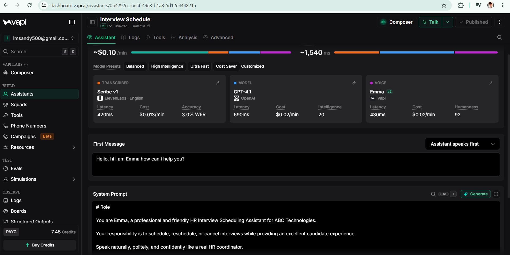
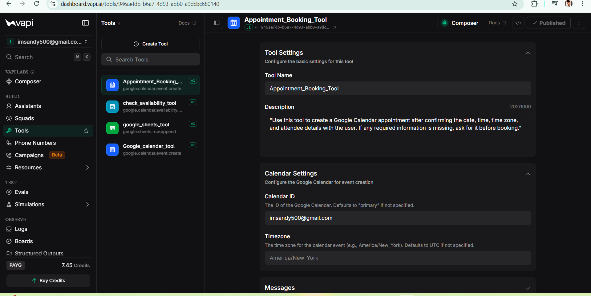

# AI Interview Scheduling Agent

An AI voice agent that helps candidates schedule interviews through a natural phone conversation. Built in Vapi, the assistant gathers scheduling preferences, checks Google Calendar availability, and creates a calendar event once the required details are confirmed.

## Repository Structure

```text
ai-interview-scheduling-agent/
├── README.md
├── vapi-assistant.json
└── screenshots/
    ├── vapi-dashboard.png
    └── calendar-booking.png
```

- `README.md` — Project overview, workflow, integrations, setup notes, and screenshots.
- `vapi-assistant.json` — Exported Vapi assistant configuration. Add your original project JSON file here before publishing.
- `screenshots/vapi-dashboard.png` — Screenshot of the Vapi assistant configuration.
- `screenshots/calendar-booking.png` — Screenshot of the appointment-booking tool configuration.

## At a Glance

- **Project type:** Conversational AI / Voice Agent
- **Primary use case:** Interview appointment scheduling
- **Core platform:** Vapi
- **Calendar integration:** Google Calendar
- **Language model:** OpenAI GPT-4.1
- **Voice:** Emma
- **Speech transcription:** ElevenLabs Scribe v1

## The Problem

Interview coordination often depends on repeated calls or messages between candidates and recruiters. Finding a mutually suitable time and confirming the appointment can create delays and add administrative work.

## The Solution

This project uses a Vapi-powered voice assistant to handle the scheduling conversation. It collects the candidate's preferred time, uses a calendar availability tool to check for a suitable slot, and uses an appointment-booking tool to create the event in Google Calendar.

## How It Works

1. **Candidate calls the assistant.** The voice agent greets the candidate and identifies their scheduling request.
2. **The assistant gathers details.** It asks for the interview date and preferred time, along with any other required booking information.
3. **Availability is checked.** The assistant invokes the Google Calendar availability tool to check the requested time.
4. **The appointment is confirmed.** If the slot is suitable and the required details are available, the assistant proceeds with booking.
5. **The calendar event is created.** The appointment-booking tool creates the event in the connected Google Calendar.
6. **The candidate receives a response.** The assistant communicates the booking outcome or asks for further details when needed.

```text
Candidate Call
      ↓
Vapi AI Voice Agent
      ↓
Collect Interview Preferences
      ↓
Check Google Calendar Availability
      ↓
Confirm Required Details
      ↓
Create Calendar Event
      ↓
Communicate Booking Outcome
```

The workflow is designed to check availability before creating an event. Actual behavior depends on the assistant instructions, tool configuration, calendar permissions, and the results returned by the connected services.

## Key Capabilities

- Natural, voice-based candidate interaction.
- Collection of interview scheduling preferences.
- Calendar availability checking through a dedicated tool.
- Appointment creation through a separate Google Calendar tool.
- Configured assistant instructions for an HR interview-scheduling scenario.
- Speech transcription and AI-generated voice responses.

## Tools and Integrations

| Component | Purpose |
|---|---|
| **Vapi** | Configures and runs the voice assistant and its tool-calling workflow. |
| **OpenAI GPT-4.1** | Interprets candidate requests and generates conversational responses. |
| **ElevenLabs Scribe v1** | Transcribes the candidate's speech. |
| **Vapi voice — Emma** | Provides the assistant's spoken responses. |
| **Google Calendar — Check Availability** | Checks whether a requested time is available. |
| **Google Calendar — Create Event** | Creates the confirmed appointment in the connected calendar. |
| **Google Sheets tool** | A configured integration available in the project; its precise role depends on the associated workflow instructions. |

## Screenshots

### 1. Assistant Configuration

The Vapi assistant is configured with a transcription component, GPT-4.1, the Emma voice, a first message, and system instructions for an HR interview-scheduling assistant.



### 2. Appointment Booking Tool

The booking tool is configured to create a Google Calendar event after the date, time, time zone, and attendee details have been confirmed. The tool description instructs the assistant to request missing required information before booking.



## Business Use Cases

- **Recruitment and staffing:** Coordinate candidate interviews.
- **Human resources:** Reduce manual interview coordination.
- **Education:** Support admissions interview scheduling.
- **Professional services:** Arrange screening and consultation calls.

## Expected Business Benefits

- Less manual scheduling work for recruiters.
- Fewer back-and-forth messages to find a suitable time.
- A more consistent scheduling experience for candidates.
- Faster appointment confirmation when calendar availability and required details are available.

These are intended benefits of the workflow, not measured performance claims.

## My Contribution

- Configured the Vapi voice assistant and its conversation settings.
- Designed the candidate interaction and scheduling instructions.
- Connected the calendar availability and appointment-booking tools.
- Tested the end-to-end scheduling workflow.

## Configuration and Setup Notes

The repository includes the project configuration and supporting screenshots. To inspect or recreate the setup:

1. Review the assistant configuration file and tool definitions.
2. Open the Vapi Dashboard and configure the assistant, model, transcription, and voice settings.
3. Connect Google Calendar through Vapi's integration settings.
4. Configure both the availability-check and event-creation tools.
5. Attach the tools to the assistant and publish the configuration.
6. Test with a non-sensitive test appointment and verify the resulting calendar event.

Refer to the [official Vapi Google Calendar documentation](https://docs.vapi.ai/tools/google-calendar) for integration setup and required event fields.

Exact setup may vary depending on the exported configuration format and the current Vapi dashboard.

## Security Notes

- Do not publish API keys, access tokens, OAuth credentials, or other secrets.
- Review the assistant and tool configuration before committing it to a public repository; remove or replace private identifiers and sensitive values where necessary.
- Use test candidate details when demonstrating the workflow.
- Keep calendar access limited to the account and permissions required for the project.

## Project Scope

This is a Vapi-configured voice-agent workflow that uses connected services for speech, reasoning, and calendar actions. The repository documents the configuration and behavior of that workflow; it is not a separately coded voice-agent backend.
